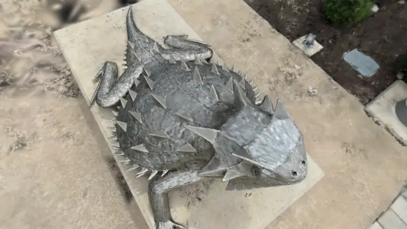
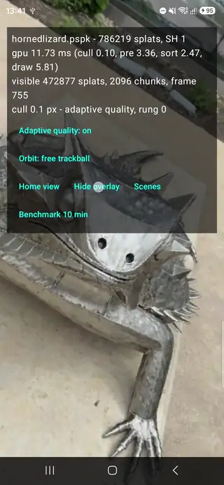
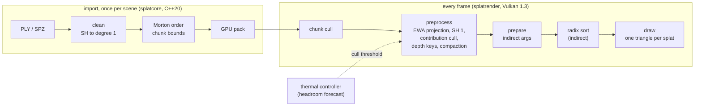
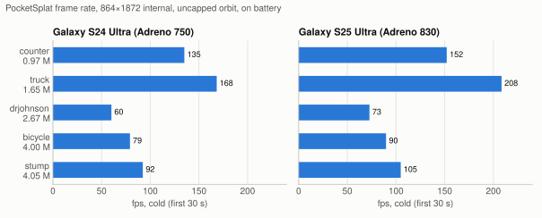
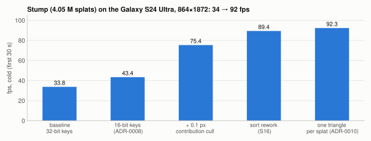
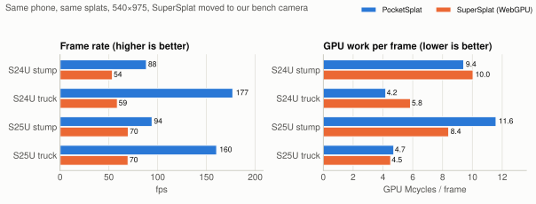
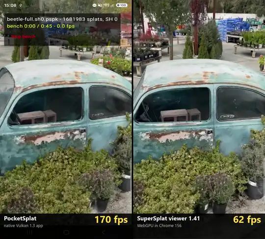
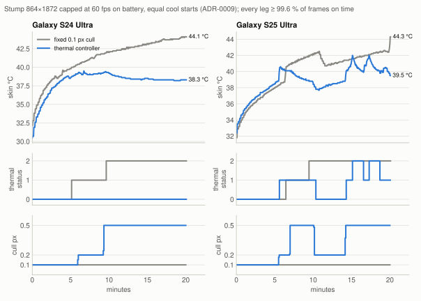
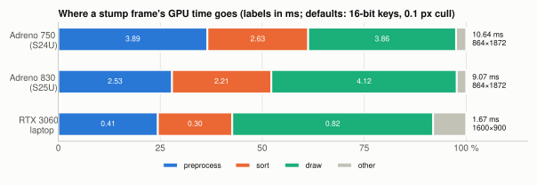

# PocketSplat

**A native Vulkan 1.3 renderer for 3D Gaussian Splatting on Android phones, with every number
measured like-for-like against the renderers people actually use: same phone, same splats, same
pixels, public scenes.**

<p align="center">
  
</p>
<p align="center"><sub>The bundled sample scene (hornedlizard, 786 K splats, nianticlabs/spz, MIT), rendered
by the desktop host from the app's start view. The renderer, import pipeline and start view are the phone's.</sub></p>

The renderer is a GPU compute pipeline written from the papers for mobile GPUs: chunk cull, a
compacting preprocess, a radix sort that needs no inter-workgroup waits, and one indirect draw.
A portable C++20 core does PLY/SPZ import and cleaning. The measurement harness records per-pass GPU
timestamps, thermal state and power into committed CSVs. Things that turned out slower are kept as
negative results.

| **92 fps** | **20 min at 60 fps, thermal status 0** | **2.4 ns per key** |
|---|---|---|
| A 4.05 M-splat scene (stump) at 864×1872 on a Galaxy S24 Ultra (Adreno 750), cold. It ran at 34 fps when it first rendered. 105 fps on a Galaxy S25 Ultra (Adreno 830). | A thermal controller trades image quality for heat using Android's headroom forecast. Over 20 min of stump on battery the S24 Ultra stayed at status 0 and used 26 % less energy per frame than at the fixed setting, which reached status 2 at 9.6 min. | GPU radix sort of 16-bit depth keys at 1 M keys on the Adreno 750 (4.3 ns with 32 bits). It uses no forward-progress assumptions and no fixed subgroup size. |

## Try it



The clip on the right is a screen recording on the Galaxy S24 Ultra: hornedlizard (786 K splats),
then beetle (1.0 M splats after cleaning). The touch dots are the recording's. The full 106 s
recording, with the HUD's per-pass GPU times, is attached to the release.

* **Android** (arm64, Android 13+, a Vulkan 1.3 GPU): install `pocketsplat-0.1.0.apk` from the
  [Releases](../../releases) page. Side-loaded, not on the Play Store. Tested on Snapdragon 8 Gen 3
  and 8 Elite phones. The first launch opens the bundled sample. **Open PLY/SPZ file…** imports
  any 3DGS scene through the system file picker; it is cleaned and packed on the phone.
  One finger orbits, a pinch zooms, two fingers pan, a double tap moves the pivot to the point
  under the finger, and **Home** returns to the start view.
* **Windows** (10/11, a Vulkan 1.3 driver): unzip `pocketsplat-viewer-0.1.0-windows-x64.zip` from the
  same page and run `pocketsplat-viewer.exe`. It uses the same renderer, import and navigation as
  the phone, opens files by drag and drop, and has its controls listed in the bundled `README.txt`.
  Tested on an RTX 3060 and an Intel UHD iGPU.

<br clear="right">

## How it works



* **Import** ([docs/cleaning.md](docs/cleaning.md), [docs/formats.md](docs/formats.md)): reads PLY
  (SH 0–3) and SPZ, converts the coordinate system (RDF → RUB with an SH parity table) and truncates
  SH to degree 1. It removes floaters and degenerate splats, sorts in Morton order and writes a
  32-byte-per-splat GPU pack with conservative chunk bounds.
* **Frame**: everything after the chunk cull is GPU-driven. The preprocess projects each splat
  (EWA), evaluates SH 1, drops splats that would cover less than 0.1 px
  ([ADR-0008](docs/decisions/ADR-0008-contribution-culling-and-16-bit-keys-on-the-phone.md)), and
  appends the survivors with 16-bit log-depth keys. A one-thread pass turns the GPU-written count
  into the sort's dispatch and the draw's arguments, so the CPU never reads a count back. The sort
  is an own reduce-then-scan LSD radix sort
  ([ADR-0004](docs/decisions/ADR-0004-own-reduce-then-scan-radix-sort.md),
  [docs/sorting.md](docs/sorting.md)). The draw evaluates each Gaussian in its own eigenbasis
  ([ADR-0006](docs/decisions/ADR-0006-eigenbasis-oriented-quad-kernel.md)) on one triangle per
  splat ([ADR-0010](docs/decisions/ADR-0010-one-triangle-per-splat.md)).
* **On the phone**: frames are drawn only when something changes, so an idle viewer keeps the GPU
  at 0 %. The start view is placed near the capture trajectory, estimated from the splats alone
  ([ADR-0012](docs/decisions/ADR-0012-interactive-navigation.md)), and the quality controller
  moves the cull threshold along a measured ladder
  ([ADR-0009](docs/decisions/ADR-0009-thermal-adaptive-quality-controller.md),
  [ADR-0011](docs/decisions/ADR-0011-the-controller-in-interactive-use.md)).

The code uses Vulkan 1.3 core only (dynamic rendering, synchronization2, timeline semaphores), no
vendor extensions and no 64-bit atomics, with GLSL compiled to SPIR-V at build time.

## Results

Galaxy S24 Ultra (Snapdragon 8 Gen 3, Adreno 750) and Galaxy S25 Ultra (Snapdragon 8 Elite,
Adreno 830), SH 0, and identical splats for every renderer. The scenes are the public INRIA
Mip-NeRF 360 / Tanks and Temples / Deep Blending pretrained models, cleaned. They are under a
research licence, so they appear here only as numbers. Method, full tables and caveats are in
[docs/benchmarks/public-baseline.md](docs/benchmarks/public-baseline.md) and
[docs/benchmarks/README.md](docs/benchmarks/README.md). Every figure is regenerated from the
committed CSVs by [scripts/plot_readme.py](scripts/plot_readme.py).

<picture>
  <source media="(prefers-color-scheme: dark)" srcset="docs/figures/cold-fps-dark.svg">
  
</picture>

Cold frame rate at the app's resolution (864×1872 internal) over an uncapped orbit on battery,
median of the first 30 s, mean of two rounds, measured 2026-10-31
([CSV](docs/benchmarks/readme-cold-2026-10-31.csv)):

| Scene | Splats | S24 Ultra | S25 Ultra |
|---|---|---|---|
| counter | 0.97 M | 135 | 152 |
| truck | 1.65 M | 168 | 208 |
| drjohnson | 2.67 M | 60 | 73 |
| bicycle (budget 4 M) | 4.00 M | 79 | 90 |
| stump | 4.05 M | 92 | 105 |

Truck runs where frame pacing, not the GPU, sets the rate (rounds 163/174 and 176/241 fps). The
other scenes' two rounds differ by 0.4–9 %.

<picture>
  <source media="(prefers-color-scheme: dark)" srcset="docs/figures/stump-history-dark.svg">
  
</picture>

Four changes moved the stump frame rate on the S24 Ultra:
* **16-bit depth keys**: log depth over the frame's depth range, which halves the sort's passes.
* **Contribution culling** before the sort: splats that cover less than 0.1 px are dropped. With
  the 16-bit keys this took stump from 34 to 75 fps, at ≥ 43.5 dB PSNR against exact rendering
  ([ADR-0008](docs/decisions/ADR-0008-contribution-culling-and-16-bit-keys-on-the-phone.md)).
* **Sort rework** ([docs/sorting.md §7](docs/sorting.md)): a parallel per-digit spine, a lighter
  scatter and occupancy tuning. This took the sort from 8.3 / 4.4 to 4.3 / 2.4 ns per key
  (32 / 16 bits) on the 750.
* **One triangle per splat** ([ADR-0010](docs/decisions/ADR-0010-one-triangle-per-splat.md)): the
  quad became a single triangle, which cut draw time by 12–19 %.

### Against other renderers on the same phone

<picture>
  <source media="(prefers-color-scheme: dark)" srcset="docs/figures/supersplat-pose-dark.svg">
  
</picture>

<p align="center">
  
</p>

The clip compares the two renderers on the same S24 Ultra, recorded one after the other:
* **Same inputs**: the same 1.68 M splats (beetle, CC BY 4.0), the same 540×975 canvas, and the
  same camera path. The path is a ±30° swing about the start view that advances 0.2° per rendered
  frame, so the faster renderer gets further through it.
* **Labels**: per-second fps from each run's CSV.
* **Pacing**: Chrome holds the page at about 70 Hz with the GPU 78 % busy, so most of the 2.4× gap
  here is the browser's pacing.
* **Per frame**: PocketSplat's GPU spends 27–29 % fewer cycles (5.1 vs 7.0 M while recorded, 4.5 vs
  6.3 M without recording).

The full 16 s MP4 is on the release. The runs are in the
[CSV](docs/benchmarks/side-by-side-s24u-f89eb4d-2026-11-03.csv).

* **SuperSplat viewer (PlayCanvas, WebGPU), 540×975, same canvas.** Both renderers use our bench
  camera, which keeps SuperSplat rendering every frame.
  * S24 Ultra: stump **95** vs 61 fps, bicycle **83** vs 59, drjohnson **70** vs 52.
  * S25 Ultra: stump **106** vs ≥ 71, bicycle **90** vs ≥ 70, drjohnson **77** vs ≥ 69.
  * Chrome paces the page at about 68–72 Hz with the GPU 61–79 % busy, so SuperSplat's numbers are
    lower bounds.
  * Its default camera is 35–45 % cheaper per frame than our orbit, so cost comparisons move it to
    our pose.
* **Energy at equal work** (ours capped at SuperSplat's rate, 10 min on battery):
  * Truck: **38.8 vs 50.9** mJ per frame on the S24 Ultra and **31.1 vs 46.0** on the S25 Ultra.
  * Stump: parity on the S24 Ultra (9.2 vs 10.2 M GPU cycles per frame). On the S25 Ultra ours
    still spends 9 % more (72.1 vs 66.3 mJ).
* **splatkit** (native Vulkan, MIT), pose-matched orbit on the S25 Ultra, 864×1872:
  * PocketSplat's GPU frame is 23–52 % shorter on all six scenes (heavy scenes 10.5–15.0 ms vs
    16.5–25.8).
  * At splatkit's half-scale canvas, splatkit wins stump. Its sort is about 1.6× cheaper per key.
* **Sustained**, 10 minutes on battery at 540×975 from a cool start:
  * S24 Ultra: stump 96 → **67** fps, truck 174 → **156**.
  * S25 Ultra: stump 99 → **68.5**, truck 237 → **154**.
  * Ours runs uncapped and reaches thermal status 2 within 1.5–5 min. SuperSplat, paced by the
    browser, holds 53–68 fps at status 0.

### Thermal-adaptive quality

<picture>
  <source media="(prefers-color-scheme: dark)" srcset="docs/figures/controller-ab-dark.svg">
  
</picture>

The controller ([ADR-0009](docs/decisions/ADR-0009-thermal-adaptive-quality-controller.md)) reads
Android's 30 s thermal-headroom forecast and moves the contribution threshold along a measured
ladder (0.1 → 0.2 → 0.5 px). The test ran stump at 864×1872 and 60 fps for 20 min on battery, both
legs from the same start temperature
([CSV](docs/benchmarks/controller-ab-1d3faec-2026-10-29.csv)):
* **S24 Ultra**: the controller settled at 0.5 px and never left status 0 (skin max 39.5 °C). The
  fixed setting reached status 2 at 9.6 min (44.1 °C).
  * Energy per frame fell 26 % and GPU cycles 47 %.
  * The image cost was 46.1 → 39.1 dB mean PSNR.
* **S25 Ultra**: the ladder runs out at this frame rate. Status 2 moved from 9.5 to 15 min, with
  26 % less energy per frame.
* Every leg held 60 fps.

<picture>
  <source media="(prefers-color-scheme: dark)" srcset="docs/figures/frame-breakdown-dark.svg">
  
</picture>

Where a stump frame's GPU time goes with the default settings:
* **Adreno 750**: preprocess and draw take about 3.9 ms each of 10.6 ms.
* **Adreno 830**: the draw takes 4.1 of 9.1 ms. The cost per drawn splat, not the sort, is what
  separates it from SuperSplat on stump.

## Engineering notes

These bugs and traps cost the most time. Each one links to where it is written up with
measurements.

**Correctness**
* **Mirrored screen-space covariance.** Vulkan's y-down NDC was handled in the projection matrix,
  but the EWA Jacobian kept a positive focal_y. Every splat's 2D covariance was therefore the
  y-mirror of the truth, and diagonal elongated splats drew *across* their features.
  * The eigenvalues are unchanged, so PSNR-against-self goldens and every eigenvalue-based guard
    were blind to it.
  * A synthetic chirality test now gates it
    ([docs/silhouette-rays-research.md](docs/silhouette-rays-research.md)).
* **fp32 cancellation in the conic** of needle-thin splats produced indefinite conics, which
  showed up as straight rays at silhouettes. It was fixed structurally by evaluating the kernel in
  the eigenbasis ([ADR-0006](docs/decisions/ADR-0006-eigenbasis-oriented-quad-kernel.md)).
* **A cleaning default that hollowed out trained scenes.** A thin-axis prune removed 8–69 % of the
  splats in trained scenes, costing 5–10 dB on one of them
  ([ADR-0007](docs/decisions/ADR-0007-prune-scale-keeps-flat-splats.md)).

**Mobile drivers**
* **Per-invocation arrays across barriers** (`uint x[16]`): the Adreno 750 driver miscompiled them
  silently. 99 % of sorted values came out wrong, with no error. The sort keeps such state in
  scalars and is verified on the phone ([docs/sorting.md §8](docs/sorting.md)).
* **A constant lookup table** for quad corners made every vertex invocation about 10× slower on the
  750. The image was correct and the RTX got faster. Corners are now computed with bit masks.
* **Recycled `VkBuffer` handle values** on Adreno silently invalidated a descriptor cache keyed on
  them.

**Measurement**
* **A racy visible-count readback** made the device sort look 3–4× more expensive per key than it
  is. One host-visible counter was shared by both frames in flight
  ([docs/sorting.md §6](docs/sorting.md)).
* **Engine ticks counted as frames.** Early SuperSplat numbers counted the engine's ticks rather
  than rendered frames: a desktop self-test showed 137 "fps" while 57 frames were rendered. Every
  affected row was corrected in public-baseline.md.
* **The thermal forecast lies for its first ~20 s.** Android fits its slope to as few as three
  one-second skin samples, so a 1 °C sensor step reads as +15 °C. The controller ignores that
  window.
* **The S25 Ultra's skin sensor steps.** It jumps +1.4–2.5 °C when rising through about 38.7 °C
  while the processor temperature stays flat. What first looked like a controller oscillation was
  this sensor model.

The [negative results log](docs/benchmarks/README.md#negative-results-log) has 31 entries. Each
one gives what was tried, the measurement and the diagnosis. Examples: block-staged
and subgroup-ranked scatters (faster on the RTX, neutral or wrong on the 750), lowering the internal
resolution as a thermal rung (no power saved), and copying draw records into sorted order
(+18–25 % frame time).

## Known limitations

* **Scene size on the Adreno 750**: at most 4,194,304 splats per scene. That is the 128 MB
  storage-buffer range divided by 32 B draw records. Larger scenes are budget-pruned on import. The
  830 renders the full 4.48 M-splat bicycle at 65 fps.
* **SH degree 0 and 1 only**, by design: higher degrees are truncated on import.
* **Devices**: arm64, Android 13+, Vulkan 1.3. Measured on two Samsung phones with Adreno GPUs
  only; Mali and Xclipse GPUs are untested.
* **Mip-Splatting ("antialiased") scenes** render slightly softer than in viewers that apply their
  3D filter opacity term.
* **Viewer, not editor**: there is no crop or brush editing UI.
* **Start view**: on the 13 INRIA scenes, 9 open at a capture-like view
  ([CSV](docs/benchmarks/home-view-inria-2026-10-31.csv)). The rest open at a reasonable view of
  the main object, but not where the photographer stood.

## Building

*Core library, CLI and tests (Windows or Linux, CMake ≥ 3.24):*
```
cmake -B build -DCMAKE_BUILD_TYPE=Release
cmake --build build --config Release
ctest --test-dir build -C Release --output-on-failure
```

*Desktop hosts (Windows, MSVC 2022, Vulkan SDK ≥ 1.3):*
```
cmake -B build -DPOCKETSPLAT_BUILD_DESKTOP=ON
cmake --build build --config Release
build/desktop/Release/pocketsplat-desktop scene.ply --validation --frames 300   # dev host, bench flags
build/desktop/Release/pocketsplat-viewer scene.ply                              # end-user viewer
python scripts/package_windows.py                                               # release zip
```

*Android (NDK r27, minSdk 33, arm64):* `cd android && ./gradlew assembleDebug`.
[android/README.md](android/README.md) covers release signing, getting scenes onto the phone and
the benchmark mode.

*Reproducing the measurements:* test scenes are never committed. `data/manifest.json` lists every
source with its licence and SHA-256.
1. `scripts/prepare_bench_scenes.py` builds identical variants for every renderer.
2. `scripts/bench_android.py` and `scripts/bench_web.py` drive the app and the pinned web viewers
   on the phone.

The protocol is in [docs/benchmarks/README.md](docs/benchmarks/README.md).

## Repository

```
core/            splatcore: PLY/SPZ I/O, cleaning, Morton order, GPU pack, import, start view,
                 quality-controller policy; GoogleTest suite
tools/splatconv/ CLI: inspect | convert | clean | pack | coverage | replay
render/          splatrender: Vulkan 1.3 renderer, radix sort, shaders, sortbench
desktop/         pocketsplat-desktop (dev/bench host, golden images) and pocketsplat-viewer
android/         Kotlin + Compose app, NDK host, JNI bridge
scripts/         benchmark drivers (app, web viewers), scene preparation, figures, packaging
docs/            formats, cleaning, sorting, ADRs (docs/decisions), benchmarks (CSVs + method)
```
Documentation map: [docs/README.md](docs/README.md).

## Dependencies

All are MIT, BSD, Apache-2.0 or zlib, pinned via CMake FetchContent:
* Niantic spz (with zlib and zstd), glm, volk, Vulkan Memory Allocator, vk-bootstrap
* GLFW and Dear ImGui (desktop)
* GoogleTest

The web viewers used as baselines are fetched only at benchmark time. Licence lines are in
[THIRD_PARTY.md](THIRD_PARTY.md).

## References

* Kerbl, Kopanas, Leimkühler, Drettakis — *3D Gaussian Splatting for Real-Time Radiance Field
  Rendering*, SIGGRAPH 2023
* Zwicker, Pfister, van Baar, Gross — *EWA Splatting*, TVCG 2002
* Niantic — SPZ format and reference library
* Mobile results compared against:
  * Hou et al. (Qualcomm), *Sort-free Gaussian Splatting via Weighted Sum Rendering*
    (arXiv 2410.18931)
  * Han et al., *WebSplatter* (arXiv 2602.03207)
  * Du et al., *Mobile-GS* (ICLR 2026)
* Renderers measured: PlayCanvas SuperSplat viewer, Spark (World Labs), splatkit

## License and scene credits

MIT ([LICENSE](LICENSE)). The renderer, sort and cleaning pipeline are implemented from papers and
public specs, not ported from copyleft or non-commercial code.

* *hornedlizard* and *racoonfamily* are sample assets of
  [nianticlabs/spz](https://github.com/nianticlabs/spz) (MIT, © 2024 Niantic Labs). hornedlizard
  ships in the app and the Windows zip.
* *beetle*, shown in the phone recording and the side-by-side clip, is from the
  [loopce/gaussiansplats](https://huggingface.co/datasets/loopce/gaussiansplats) dataset under
  [CC BY 4.0](https://creativecommons.org/licenses/by/4.0/). It was cleaned for each: to 1.0 M
  splats for the recording and at full count (1.68 M) for the side-by-side. It is not
  redistributed here.
* The INRIA 3DGS pretrained models (Mip-NeRF 360, Tanks and Temples, Deep Blending) are used for
  measurements only. They are not redistributed and not shown.
