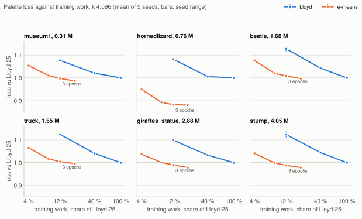
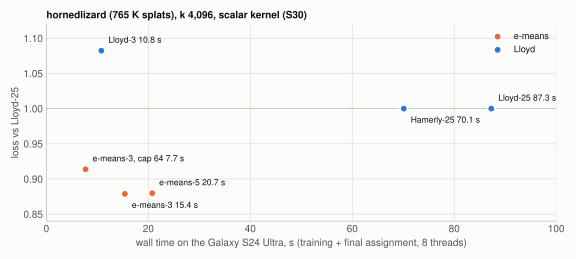
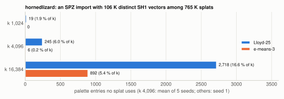

# e-means against Lloyd: training an SH 1 palette on a phone

PocketSplat stores each splat's degree-1 spherical-harmonic colour terms (SH1: 3 coefficients ×
3 colour channels, 9 floats) as a 16-bit index into a palette of 4,096 SH1 vectors
([ADR-0017](decisions/ADR-0017-sh1-palette.md)). The palette is trained on the phone while a scene is
imported, from 0.3 M to 4 M splats. That makes it a k-means problem with an unusual budget: d = 9,
n up to millions, k = 4,096, and a user waiting for the import to finish on a phone CPU.

This page compares the two trainers that were measured for that job. **Lloyd** is the textbook
k-means: every epoch assigns every point to its nearest centroid, then moves each centroid to the
mean of its points. **e-means** (Meta FAIR, [arXiv 2611.09501](https://arxiv.org/abs/2611.09501),
2026) is a mini-batch k-means with exponential-moving-average centroid updates, a step size and
batch size from published scaling laws, and revival of dead clusters. It was implemented here from
the paper, in `core/src/palette.cpp`. The full protocol, the implementation's deviations from the
paper and every number are in [sh1-palette-research.md](sh1-palette-research.md) §3 and §6. This page
is the short version.

**The result in one line**: on the S24 Ultra, e-means with 3 epochs trains a *better* palette for the
bundled sample scene than Lloyd with 25 epochs, in a sixth of the time (15.4 s against 87.3 s on
the scalar kernel, 3.1 s with NEON). At equal time it is 19 % lower in loss than Lloyd.

## How the comparison was run

* **Scenes**: six, from 0.31 M to 4.05 M splats, imported at SH 1 as the app imports them: museum1,
  hornedlizard (the bundled sample, an SPZ file), beetle, giraffes_statue, and INRIA truck and stump.
* **Loss**: the mean squared distance from every splat's SH1 vector to its palette entry, divided
  by Lloyd-25's loss with the same seed. Below 1.0 is better than 25 epochs of Lloyd.
* **Work**: point-to-centroid distance evaluations during training, a machine-independent count,
  divided by Lloyd-25's (n × k × 25).
* **Time**: only from the Galaxy S24 Ultra (Snapdragon 8 Gen 3), 8 threads, phone unplugged and cool
  before each run. The dev laptop's times are not used: it is shared with other jobs.
* **Lloyd runs** are Hamerly-accelerated Lloyd on the desktop. They take Lloyd's iterations exactly
  (same labels, same loss) and are counted as plain Lloyd's work. On the phone, plain Lloyd ran.
* Seeds 1–5 at k 4,096; seed 1 at k 1,024 and 16,384.

## Loss against work

<picture>
  <source media="(prefers-color-scheme: dark)" srcset="figures/emeans-convergence-dark.svg">
  
</picture>

| Scene | Lloyd-3 | Lloyd-10 | e-means-1 | e-means-2 | **e-means-3** | e-means-5 |
|---|---|---|---|---|---|---|
| museum1 | 1.077 | 1.021 | 1.054 | 1.011 | **0.998** | 0.987 |
| hornedlizard | 1.083 | 1.006 | 0.950 | 0.893 | **0.883** | 0.881 |
| beetle | 1.128 | 1.043 | 1.076 | 1.021 | **1.009** | 0.997 |
| giraffes_statue | 1.099 | 1.033 | 1.037 | 1.001 | **0.990** | 0.979 |
| truck | 1.125 | 1.041 | 1.066 | 1.017 | **1.005** | 0.996 |
| stump | 1.124 | 1.044 | 1.041 | 0.999 | **0.988** | 0.979 |
| Work vs Lloyd-25 | 0.12 | 0.40 | 0.04 | 0.08 | **0.12** | 0.20 |

Loss relative to Lloyd-25, k 4,096, mean of 5 seeds
(`benchmarks/palette-trainers-1cdd4cc-2026-11-19.csv`).

* **Same work, lower loss**: e-means-3 and Lloyd-3 do the same number of distance evaluations.
  e-means-3's loss is 7–19 % lower on every scene and every seed (30 pairs).
* **Same loss, an eighth of the work**: e-means-3 is within 1 % of Lloyd-25 on all six scenes,
  and at or below it on four. e-means-5 is at or below Lloyd-25 everywhere.
* At k 1,024 e-means-3 is 0.93–1.01 of Lloyd-25, and at k 16,384 0.81–1.01. The scaling laws were
  used as published, without tuning.
* The paper fitted its laws at d = 96 and up and never tested d = 9. These runs are the first
  evidence here that the advantage carries over to such a low dimension.

## Time on the phone

<picture>
  <source media="(prefers-color-scheme: dark)" srcset="figures/emeans-phone-time-dark.svg">
  
</picture>

hornedlizard (765 K splats) on the S24 Ultra, k 4,096. Total = training plus a final assignment of
every splat. The scalar kernel was used (S30; `benchmarks/palette-trainers-s24u-e87cf48-2026-11-20.csv`):

| Run | Total | Loss vs Lloyd-25 | Unused entries |
|---|---|---|---|
| Lloyd-25 | 87.3 s | 1.000 | 243 |
| Hamerly-25 (exact Lloyd) | 70.1 s | 1.000 | 243 |
| Lloyd-3 | 10.8 s | 1.082 | 409 |
| **e-means-3** | **15.4 s** | **0.879** | **5** |
| e-means-5 | 20.7 s | 0.880 | 2 |
| e-means-3, cap 64 points per entry | 7.7 s | 0.914 | 26 |

After the NEON kernel and a dynamic work split (S31,
`benchmarks/palette-trainers-s24u-cd347ef-2026-11-23.csv`), both trainers run at the same cost per
distance evaluation, and the equal-time comparison is direct:

| Scene | e-means-3 | Lloyd-3 | e-means loss / Lloyd loss |
|---|---|---|---|
| hornedlizard (765 K) | 3.08 s | 3.11 s | 0.81 |
| stump (4.05 M) | 18.9 s | 18.6 s | 0.89 |

The S25 Ultra trains the same palettes, bit for bit, in 2.2 s and 12.0 s. The app's import adds
4.5 s at its 1 M default on the S24 Ultra.

## Dead entries

<picture>
  <source media="(prefers-color-scheme: dark)" srcset="figures/emeans-dead-dark.svg">
  
</picture>

hornedlizard came from an SPZ file, whose SH1 values are quantized: its 765 K splats hold only 106 K
distinct SH1 vectors. Lloyd's centroids settle on the dense lattice points and leave many entries
empty: 6 % of the palette at k 4,096, and 17 % at 16,384. A dead entry is wasted palette. e-means
revives clusters that fall under a tenth of the mean count by splitting a busy one. That is the
likely reason it beats Lloyd-25 by 12 % on this scene, its largest margin of the six. On the other
five scenes, Lloyd-25 and e-means-3 leave no entry empty at k 4,096.

## Does the loss show in the image?

Worst of six camera poses at 864 × 1872, PSNR against direct SH 1 (no palette), seed 1, k 4,096
(`benchmarks/palette-quality-emeans-4cee8a0-2026-11-20.csv`, `palette-quality-c6f0a7f-2026-11-19.csv`):

| Scene | SH 0 (no SH1 at all) | Lloyd-25 palette | e-means-3 palette |
|---|---|---|---|
| giraffes_statue (hardest) | 29.6 dB | 42.6 dB | 41.8 dB |
| hornedlizard | 35.3 dB | 51.3 dB | 52.4 dB |

Both palettes are far above SH 0 and above the 40 dB bar. The difference between them is within
about 1 dB either way. On giraffes_statue e-means' loss is 1 % lower, yet its worst pose is 0.8 dB
lower: SH1-space loss ranks palettes, but it does not fix the worst-pose PSNR to a fraction of a dB.
The case for e-means here is time and dead entries, not image quality.

## What did not work, and limits

* **Hamerly's bounds** save only 6–30 % of Lloyd's work on SH1 data. The second-nearest centroid is
  only ~13 % farther than the nearest, and the largest centroid drift per epoch eats that gap. This
  is a negative result; Hamerly stays in the code as an exact check of Lloyd.
* **A training cap** (64 points per entry) cuts e-means' work to 1–4 % of Lloyd-25. On four scenes it
  costs 6–8 % loss. Since NEON made full training 3–19 s, the import does not use it.
* e-means pays a barrier per mini-batch. With an equal static work split, the S24 Ultra's two small
  cores made it 12–58 % slower per distance evaluation than Lloyd. A dynamic split removed that.
* The paper is a preprint (v1). Its own headline numbers (embedding datasets, 200–3,072 dimensions)
  are not reproduced here; only this palette task is.

Figures: `python scripts/plot_emeans.py`, regenerated from the committed CSVs.
