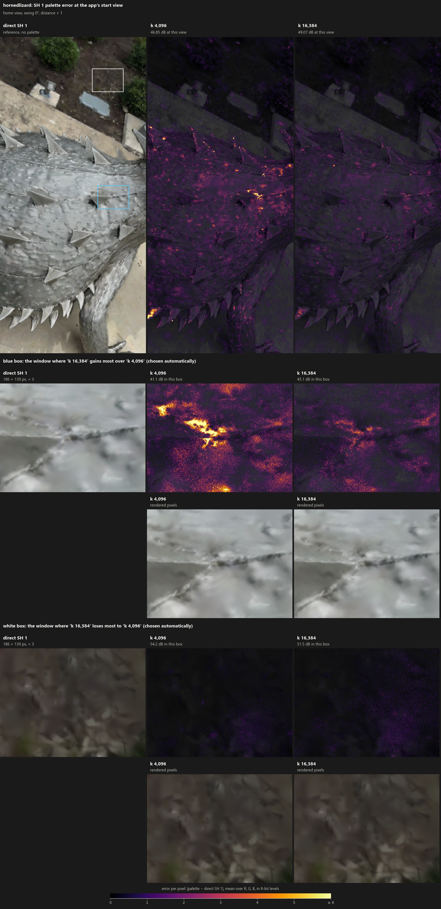

# SH 1 palette size: 16,384 entries against 4,096

PocketSplat stores each splat's degree-1 spherical-harmonic colour terms (SH1, 9 floats) as a 16-bit
index into a palette of SH1 vectors, trained with e-means (3 epochs) while a scene is imported
([ADR-0017](decisions/ADR-0017-sh1-palette.md), [e-means against Lloyd](e-means-vs-lloyd.md)). The
palette has 4,096 entries at every import budget. Phase 10 asked whether 16,384 entries are worth
their training time, first for "all" imports (no splat budget), where scenes are largest.

**The result in one line**: 16,384 entries gain **+0.9 to +2.6 dB at the view the app opens with**,
on all six test scenes and every seed, and as much at the standard quality poses. The gain does not
grow with scene size, but the training time grows with it: **4.4–4.6× the palette time** of 4,096
entries on the S24 Ultra, **96 s instead of 21 s for a 4.05 M scene**. Rendering cost, ABBA order:
preprocess +2.3 %, frame +1.6 to +2.1 % at 1 M on the S24 Ultra; +2 to +4 % and up to +1.7 % at
4.05 M on the S25 Ultra. **Decision (owner, 2026-11-26): imports train 16,384 entries up to 1 M
splats and 4,096 above** (ADR-0017 amendment, `splatcore::sh1_palette_for_count`). On the S24 Ultra
a 1 M import with the rule takes 24 s instead of 5.6 s.

## 1. Protocol

Six scenes from 0.31 M to 4.05 M splats, e-means with 3 epochs (the import's trainer), three seeds.
Each 16,384-entry palette is paired with the 4,096-entry palette of the same seed. All renders are
864 × 1872 (the phone's portrait frame), compared against the scene's direct SH 1 pack (no palette)
with 32-bit sort keys and no contribution cull. Training on the desktop used 4 threads at idle
priority; both sizes used the same thread count.

Two sets of views:

* **Home view (deciding)**: the camera the app opens a scene with
  ([ADR-0014](decisions/ADR-0014-home-view-eye-by-view-score.md)), swung 0°, ±12.5° and ±25° about
  the up axis, at its own distance and at 0.6 of it: ten poses (`scripts/palette_home_ab.py`).
  It is close to the scene's fine detail, which is what users look at first.
* **Gate A poses**: the six orbit poses every palette and quantization change has been measured at
  (`scripts/quality_ab.py`, four at the scene's framing distance, two at 0.6 of it). They look at the
  scene from outside its capture, where floaters can fill the frame. Kept for continuity with
  ADR-0017's numbers.

Sources: `benchmarks/palette-size-f4f28ac-2026-11-26.csv` (gate A, `scripts/palette_ab.py --trainer
emeans --epochs 3 --k 4096 16384 --seed 1 2 3`) and `benchmarks/palette-size-home-f4f28ac-2026-11-26.csv`.

## 2. Image quality

Worst-pose PSNR against direct SH 1, mean of three seeds (dB), and the change from 4,096 to 16,384
entries. n / k is the number of splats per palette entry at 16,384.

| Scene | Splats | n / k | Home: k 4,096 | k 16,384 | Δ | Gate A: k 4,096 | k 16,384 | Δ | SH1 loss ratio |
|---|---|---|---|---|---|---|---|---|---|
| museum1 | 314,457 | 19 | 46.84 | 48.19 | **+1.35** | 47.58 | 48.83 | +1.25 | 0.63 |
| hornedlizard | 764,985 | 47 | 45.05 | 47.60 | **+2.55** | 52.00 | 54.37 | +2.37 | 0.46 |
| beetle | 1,681,983 | 103 | 45.89 | 47.07 | **+1.18** | 47.05 | 49.66 | +2.61 | 0.68 |
| truck | 1,653,927 | 101 | 46.89 | 47.94 | **+1.04** | 51.91 | 53.15 | +1.24 | 0.67 |
| giraffes_statue | 2,880,821 | 176 | 45.44 | 46.91 | **+1.47** | 42.59 | 46.03 | +3.44 | 0.68 |
| stump | 4,049,567 | 247 | 46.76 | 47.72 | **+0.96** | 52.60 | 53.54 | +0.94 | 0.70 |

* **Every one of the 180 paired home-view poses improves**, by +0.56 to +3.18 dB. The spread over
  seeds at 4,096 entries is at most 0.27 dB (beetle), so the gain is far outside it.
* The SH1 loss (mean squared distance of a splat to its entry) falls to 0.46–0.70 of the 4,096 loss.
  The PSNR gain follows it: hornedlizard, with the largest loss drop, gains most.
* **The gain does not grow with scene size.** museum1 (19 splats per entry) gains +1.35 dB, stump
  (247 per entry) +0.96. Training work grows with the splat count, so the price per dB is lowest on
  small scenes. A rule by imported splat count fits the data better than "only for all imports".
* hornedlizard is an SPZ import with only 106 K distinct SH1 vectors among 765 K splats: 859–892 of
  its 16,384 entries stay unused, and it still gains most.
* **At the default 1 M budget** the gain is the same size: stump imported with `splatconv import
  --budget 1000000` (the app's import, seed 1), against the direct 1 M import at the home view,
  50.99 → 52.10 dB worst pose (+1.11), 51.95 → 52.81 mean (+0.86); one seed
  (`benchmarks/palette-size-home-1m-52e8ed1-2026-11-26.csv`).
* SH 0 (no SH1 at all) is at 29.6–38.7 dB worst pose: both palette sizes are far above it and above
  the 40 dB bar.
* Pack size: +147 KB (12 B per extra entry), nothing per splat.

### Where the gain lands

Per-pixel error against direct SH 1 at the home view (seed 1), on one shared colour scale, over the
reference in dimmed grey. Below each overview: the window where 16,384 entries gain most and the one
where they lose most, both chosen from the error maps with no hand-picking, enlarged × 3, with the
rendered pixels under the error maps (`scripts/make_palette_error_media.py`).

* The 4,096-entry error is not spread evenly: it peaks at 4–6+ levels on bright, view-dependent
  surfaces (the lit ridge of hornedlizard's back, stump's sunlit leaves), where a splat's SH1 vector
  is far from its entry. 16,384 entries remove most of these peaks.
* Side by side, the rendered crops are hard to tell apart at a glance: the gain is in the error
  peaks, not in a visible change over the whole frame. Where 16,384 entries lose, the error is
  below one level at either size.

## 3. Training time

Palette training plus the final assignment of every splat, e-means 3 epochs, 8 threads, NEON kernel,
seed 1 (`benchmarks/palette-size-trainers-s24u-f3c295b-2026-11-26.csv`,
`…-s25u-f3c295b-2026-11-26.csv`, `scripts/palette_trainers.py run --adb`). Losses and dead entries
match the desktop's (4 threads) to the six printed digits. The work is 4× the point–centroid pairs.
The S24U ran on battery all day. Its deciding rows are one call per run, each after a cool start
(skin ≤ 32 °C; `build` 0118e0f, the same palettebench binary as f3c295b's). The morning rows and
the S25U's are two back-to-back runs per call: the second starts warm, so ratios use the first.

| Phone | Power | Scene | k 4,096 | k 16,384 | Ratio |
|---|---|---|---|---|---|
| S24 Ultra (deciding) | battery | hornedlizard 0.76 M, cool start | 3.8 s | 16.9 s | **4.4×** |
| S24 Ultra (deciding) | battery | stump 4.05 M, cool start | 20.8 s | **96.2 s** | **4.6×** |
| S24 Ultra | battery | hornedlizard, morning, 2 runs | 3.4 / 4.5 s | 15.1 / 16.7 s | 4.4× |
| S25 Ultra | charging | hornedlizard 0.76 M, 2 runs | 2.1 / 2.2 s | 12.2 / 11.5 s | 5.8× |
| S25 Ultra | charging | stump 4.05 M, 2 runs | 13.0 / 13.7 s | 59.8 / 70.1 s | 4.6× |

* **A 4.05 M "all" import's palette stage goes from about 21 s to about 96 s on the S24U.** The
  k 16,384 stump run ended at thermal status 2 (skin 32.0 → 42.5 °C); the phone then needed over
  30 minutes on the desk to fall back below 34 °C. At the default 1 M budget the palette stage would
  grow from 4.5 s (ADR-0017) to about 20 s, scaled by the measured ratio.
* Above 4× on every first run. The 16,384-entry table is 590 KB instead of 147 KB and may no
  longer fit a core's L2, but heat is a second candidate (not separated here).
* A second round of S24U cool-start runs was stopped after one row (the owner needed the phone):
  hornedlizard k 4,096 3.3 s, from 34 °C.

## 4. Rendering cost (gate C)

The renderer reads one 12-byte entry per visible splat in the preprocess pass; at 16,384 entries the
table is 192 KB instead of 48 KB. Stump at the default 1 M budget and at all 4.05 M, the app's
defaults (16-bit keys, contribution cull 0.1 px), 1872 × 864, 5-minute runs, on the charger
(`benchmarks/palette-size-gatec-s25u-bdc7953-2026-11-26.csv`). Packs from `splatconv import` (the
app's import), the APK unchanged (debuggable 0.4.0-bdc7953). Two runs per pack in ABBA order: run 1
k 4,096 then k 16,384, run 2 k 16,384 then k 4,096, each after a cool-wait (skin ≤ 36 °C).

**S24 Ultra (deciding), 1 M** (`benchmarks/palette-size-gatec-s24u-9522b74-2026-11-26.csv`; APK
debuggable 0.5.0-9522b74, the rule's build; ABBA as above; on the charger; the phone did not get back
under 36 °C within the 15-minute cool-wait before the first two runs, 36.6 °C at the start of the
second; thermal status 2 at minute 4–5 in all four):

| Window | Preprocess k 4,096 | k 16,384 | Δ | GPU frame k 4,096 | k 16,384 | Δ | fps |
|---|---|---|---|---|---|---|---|
| 0–30 s | 2.441 / 2.459 | 2.500 / 2.517 | **+2.4 %** | 6.71 / 6.78 | 6.78 / 6.99 | +2.1 % | 146.7 → 143.6 |
| min 4–5 | 3.466 / 3.465 | 3.546 / 3.544 | **+2.3 %** | 9.18 / 9.19 | 9.26 / 9.40 | +1.6 % | 108.7 → 107.0 |

* The S24U resolves the cost at 1 M: preprocess +2.3 % in both orders (each pair within 0.02 ms),
  frame +1.6 to +2.1 %, about 1.6 fps of 108 sustained.

S25 Ultra, preprocess and GPU frame in ms (run 1 / run 2), and the change of the two-run mean:

| Splats | Window | Preprocess k 4,096 | k 16,384 | Δ | GPU frame k 4,096 | k 16,384 | Δ |
|---|---|---|---|---|---|---|---|
| 1 M | 0–30 s | 1.368 / 1.403 | 1.449 / 1.383 | +2.2 % | 5.86 / 5.96 | 5.99 / 5.81 | 0.0 % |
| 1 M | min 4–5 | 2.187 / 2.184 | 2.278 / 2.081 | −0.3 % | 8.57 / 8.56 | 8.73 / 8.07 | −1.9 % |
| 4.05 M | 0–30 s | 2.521 / 2.513 | 2.585 / 2.554 | **+2.1 %** | 9.31 / 9.29 | 9.37 / 9.31 | +0.4 % |
| 4.05 M | min 4–5 | 3.786 / 3.775 | 3.954 / 3.891 | **+3.8 %** | 13.91 / 13.87 | 14.23 / 14.01 | +1.7 % |

* **At 4.05 M, k 16,384 is slower in both orders**: preprocess +1.6 to +4.4 % per pair, GPU frame
  +0.2 to +2.3 %, fps 71.9 → 70.8 at minute 4–5.
* At 1 M the difference is within the order effect: in run 2 the k 16,384 run was the session's
  first and started from 28.2 °C skin (all others at 35.3–36.0 °C, the cool-wait's bar), and it is
  the fastest of the four at minute 4–5. No cost is resolved at 1 M on the S25U.
* For scale, ADR-0017's gate C found the 4,096-entry palette 2–4 % faster than direct SH 1 in
  preprocess (S24U and S25U). A 16,384-entry table costs about that much back.

## 5. Decision and what is still open

The owner chose the rule by splat count (ADR-0017 amendment, S36): **16,384 entries up to 1,000,000
imported splats, 4,096 above.** The gain is the same at every size, the training time grows with
the count: below the threshold the larger palette adds about 15 s to an import on the S24U, above
it the 4.6× training (96 s for 4.05 M, thermal status 2) is not worth the same +1 dB.

**The S24 Ultra check (after the decision, APK 0.5.0-9522b74 with the rule):**
* Two scripted 1 M imports of stump (`benchmarks/palette-size-import-s24u-9522b74-2026-11-26.csv`,
  on the charger, cool start ≤ 36 °C): the app picked 16,384 entries, palette stage 23.1 s both
  times (training 16.8 s + final assignment 6.1 s), import 23.9 s in total. S31's 1 M import with
  4,096 entries: palette 4.7 s, total 5.6 s (`palette-import-cd347ef-2026-11-23.csv`). The estimate
  was ~20 s, so the threshold stands.
* Gate C at 1 M: preprocess +2.3 %, frame +1.6 to +2.1 % (§4). This is the price of the +1.1 dB at
  the home view for scenes at the default budget; scenes above 1 M keep 4,096 entries and today's cost.
