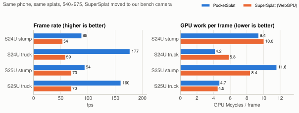
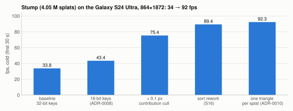
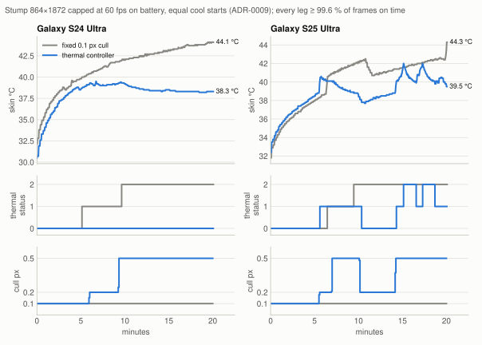

# PocketSplat: rendering 4 million Gaussians on a phone, and measuring it honestly

*A technical write-up of PocketSplat 0.1.0. Every number below comes from a CSV or a design note
in this repository, and each section links to the source. The [README](../README.md) is the short
version.*

## 1. The question

3D Gaussian Splatting represents a captured scene as a few million small, semi-transparent,
oriented ellipsoids. A renderer projects each one to the screen, sorts them by depth and blends
them back to front. On a desktop GPU this runs comfortably at hundreds of frames per second. On a
phone it is harder, and the reasons are specific (section 2).

I wanted to answer two questions with evidence rather than impressions:

1. Can a phone render real captures of 1–4 M splats at interactive rates in a native app, and
   keep doing it for ten minutes without overheating?
2. Is a native renderer measurably better than the browser renderers people already use?

When I started, the second question looked easy, because the common web viewers sorted on the
CPU. By the time I measured, it no longer was. The PlayCanvas SuperSplat viewer had moved to
WebGPU compute, with culling, projection and a GPU radix sort. splatkit, an MIT-licensed native
Vulkan renderer, had appeared. "Native is faster" was no longer something I could assume, so
most of this project went into measuring it carefully, and into finding where I lose as well as
where I win.

The test phones are a Galaxy S24 Ultra (Snapdragon 8 Gen 3, Adreno 750) and a Galaxy S25 Ultra
(Snapdragon 8 Elite, Adreno 830). Development ran on a laptop RTX 3060 with the same shaders.

## 2. A frame on a mobile GPU

Four things make a phone different from the desktop GPU that 3DGS renderers are usually written for
([docs/sorting.md §2](sorting.md)):

* **No forward-progress guarantee.** The fastest GPU sorts (Onesweep, single-pass decoupled
  look-back scans) let one workgroup spin-wait on another. That only terminates if the scheduler
  guarantees the other workgroup is running. Vulkan does not guarantee it, and mobile drivers really
  do schedule in ways that hang such code. The portable alternative, reduce-then-scan, reads the
  keys twice per digit pass instead of once.
* **Bandwidth and shared memory are 5–10× smaller**, and the sort is a memory-bound scatter.
* **Subgroup sizes vary.** Adreno runs 64-wide, Mali 16, NVIDIA 32, and an Intel iGPU reports
  anything from 8 to 32. Code that hard-codes a width breaks or crawls elsewhere.
* **Heat.** An uncapped renderer reaches thermal status 2 within 1.5–5 minutes on both phones,
  and whatever a pass costs cold, it costs more ten minutes later.

There are also hard limits. The Adreno 750 allows 128 MB per storage-buffer binding. With 32-byte
draw records for every splat, that capped a scene at 4,194,304 splats. Sizing the records for the
splats visible in a frame instead (ADR-0016) moved the cap to the 12-byte per-splat arrays, at
11,184,810 splats.

The frame I ended up with is GPU-driven after the first pass:

1. **Chunk cull.** The scene is stored in Morton order in chunks of 256 splats with conservative
   bounds. One pass culls whole chunks against the frustum and keeps the survivors in order. An
   earlier version appended them with atomics in arbitrary order. That broke the preprocess's
   Morton-coherent memory access, costing 18 % on the preprocess and 0.3–0.4 ms per frame.
2. **Preprocess.** Each surviving splat is projected with the EWA approximation and gets its
   spherical-harmonics colour (degree 0 and 1 only, by design). Splats that would cover less than
   0.1 px are dropped. The survivors are compacted, each with a 16-bit depth key.
3. **Prepare.** A single-invocation pass turns the GPU-written visible count into the sort's
   indirect dispatch and the draw's indirect arguments. The CPU never reads the count back.
4. **Sort.** My own LSD radix sort (section 3).
5. **Draw.** One triangle per splat, evaluating the Gaussian in its own eigenbasis (section 4).

Everything uses Vulkan 1.3 core features (dynamic rendering, synchronization2, timeline
semaphores): no vendor extensions, no 64-bit atomics, and no inter-workgroup waiting.

## 3. The sort

The sort is a reduce-then-scan LSD radix sort with 8-bit digits
([ADR-0004](decisions/ADR-0004-own-reduce-then-scan-radix-sort.md)). Each digit takes three
passes:
* **upsweep**: a per-block digit histogram
* **spine**: a scan of the block counts
* **downsweep**: rank the keys stably, then scatter them.

Within a subgroup, keys with the same digit find each other through an 8-round ballot match that
works at any subgroup width. Across subgroups they rank through shared count rows. It comes to
about 200 lines of GLSL and 280 of dispatch code. I wrote it myself because no permissively licensed
Vulkan sort written for Adreno existed to drop in.

**First measurement, and a bug.** The first device numbers looked strange: the sort cost up to 4×
more per key on one scene than on another. It was an instrumentation bug. The visible-count
readback used a single host-visible buffer shared by both frames in flight. The host read it while
the GPU was clearing and refilling it, so 26–65 % of the logged counts were zero and many others
partial ([docs/sorting.md §6](sorting.md)). The fix was a per-slot snapshot of the count. With exact
counts the sort cost a steady **8.3 ns per key** at 32 bits on the 750, 3.6× the RTX 3060.

**The levers, in order of size:**
* **16-bit depth keys.** Two passes instead of four halved the phone cost to 4.4 ns per key. The
  quantization is log depth over the frame's possible depth range, so the relative step is constant
  wherever the content sits. Against exact 32-bit keys the image cost was measured per scene; an
  earlier linear quantization was 1–4 dB worse on three of four heavy scenes
  ([ADR-0008](decisions/ADR-0008-contribution-culling-and-16-bit-keys-on-the-phone.md)).
* **A parallel spine.** A per-dispatch timestamp profile showed the original single-workgroup spine
  taking 35–37 % of every sort on the 750: one shader core walked the whole histogram while the rest
  of the GPU idled. One workgroup per digit removed it. The idea came from reading splatkit (MIT);
  the code was written independently.
* **Occupancy.** Shared memory per workgroup decides how many workgroups an Adreno core keeps
  resident. A sweep of the count-row footprint found the same plateau on both Adrenos: 14–18 KB is
  fastest, with a cliff above and a slope below
  ([docs/sorting.md §7](sorting.md)).

The shipped sort costs **4.34 / 2.36 ns per key** (32 / 16 bits) on the 750 and 4.03 / 2.22 on the
830 at 1 M keys, down 43–45 %. In the app, the stump scene's sort went from 4.70 to 2.51 ms.
splatkit's sort is still about 1.6× cheaper per key. The difference is in the scatter, not the
ranking method; I measured that rather than assumed it.

**Two shader shapes the Adreno 750 driver gets wrong.** Both passed on the RTX 3060 with validation
layers on and were caught only by the on-phone correctness check
([docs/sorting.md §8](sorting.md)):

1. *Per-invocation arrays across barriers.* A scatter variant kept each invocation's 16 keys in
   `uint x[16]` across barriers. On the 750, 99 % of the sorted values came out wrong and a quarter
   of the indices went missing, with no error reported. The same shader written with 16 scalar
   variables is correct.
2. *Subgroup-ranked staging*, the warp-level multisplit from the Onesweep paper. It was correct and
   2.3× faster on the RTX, and correct in a CPU model at subgroup sizes 32, 64 and 128. On the 750 it
   was wrong in every form I tried. One variant crashed the driver's pipeline compiler.

A third trap was performance, not correctness. Three small `const vec2[]` lookup tables in the
vertex shader, indexed per vertex, made every vertex about 10× more expensive on the 750 (stump draw
4.4 → 48.9 ms). The image was correct, and the RTX got faster. The corners are now computed with bit
masks. The rule I took from all three: no sort or shader change merges until it has been run and
timed on the phone, not just on the desktop.

## 4. Correctness before speed

Three bugs made images that looked plausible and passed every test I had at the time. Each one ended
with a new test that would have caught it.

**A mirrored covariance.** Vulkan's clip space has y pointing down, which I handle in the projection
matrix rather than in the data. The splat centres came from that y-negated projection. The EWA
Jacobian, however, used a positive focal length, so every projected covariance was the y-mirror of
the true one ([docs/silhouette-rays-research.md](silhouette-rays-research.md)):
* **What went wrong:** a splat trained to lean +37° drew leaning −37°. Near-axis-aligned splats are
  almost their own mirror images, so most of the image looked fine. The diagonal, elongated splats
  that training lays *along* edges, strands and folds drew *across* them, as bright spikes at
  silhouettes and a soft veil over detail.
* **Why nothing caught it:**
  * The eigenvalues are unchanged, so every size-based check passed.
  * The golden-image tests compared the renderer against its own earlier output, which had the same
    mirror.
  * The result was identical on NVIDIA and Adreno, so it didn't look like a driver bug.
* **What found it:** a side-by-side against an independent renderer at matched poses.
* **The gate now:** a synthetic chirality test renders one splat elongated along +x+y and checks the
  handedness of its projected slope.

**fp32 cancellation in the conic.** At silhouettes, a needle-thin splat's projected covariance can
have a large eigenvalue near 10⁷ px² and a small one that is pure rounding noise. Inverting that
gives an indefinite "conic", and the kernel painted straight bright rays across the screen. I
removed the inversion entirely
([ADR-0006](decisions/ADR-0006-eigenbasis-oriented-quad-kernel.md)):
* The preprocess computes the eigendecomposition in a cancellation-free form.
* It rejects splats whose smaller eigenvalue is not positive.
* The draw evaluates the Gaussian in quad-local eigenbasis coordinates.

The silhouette artifacts had two stacked root causes, this one and the mirror. Fixing either alone
left a residue that looked like the original bug.

**A cleaning default that hollowed out scenes.** My cleaning pipeline pruned splats whose smallest
axis was "needle thin", on the theory that they are noise
([ADR-0007](decisions/ADR-0007-prune-scale-keeps-flat-splats.md)):
* **The theory was tuned on three small scenes.** On trained scenes it was wrong: they are mostly
  flat, surface-aligned disks, and the thin axis is the surface.
* **Damage:** the test removed 35.5 % of the truck scene and 68.6 % of the giraffe statue. On truck
  it cost 5–10 dB against the uncleaned scene.
* **Fix:** the thin-axis test is now off by default.
* **Rule since:** every cleaning default is A/B'd by PSNR on trained scenes from fixed cameras.

## 5. Measuring honestly

A frame rate from a phone can mean very little: a cold or warm phone, a browser that caps the page,
a camera pointed at a cheap part of the scene. The protocol
([docs/benchmarks/README.md](benchmarks/README.md),
[public-baseline.md](benchmarks/public-baseline.md)) grew one rule per mistake:

* **Identical splats for every renderer.** One script cleans each scene once and writes both a PLY
  for the web viewers and a pack for the app.
* **Cold runs from a held skin temperature**, with Do Not Disturb on, heads-up notifications off,
  fixed brightness, and 120 Hz forced. Chrome otherwise paces pages at 60 Hz on these phones.
* **Count rendered frames, not ticks.** My first SuperSplat harness counted the engine's per-tick
  event, which fires whether or not the on-demand viewer rendered anything. A desktop self-test
  showed 137 "fps" while 57 frames were rendered. Every earlier SuperSplat number was an upper
  bound, and I published the correction next to them.
* **Same camera.** SuperSplat had been orbiting its own default view all along: an 85° field of
  view at a distance computed from the full bounding box.
  * **How much cheaper:** on the stump scene at 540×975 that view lit 7 % of the canvas, while my
    bench camera lit 46 %.
  * **The fix:** the harness now drives SuperSplat along my camera path from inside the page. At
    that pose its frame costs 57 % (stump) and 78 % (truck) more GPU cycles than at its own view.
  * **What it explained:** an energy gap I had attributed to my renderer was mostly the camera.
* **GPU cycles per frame, not milliseconds, at a fixed frame rate.**
  * **The governor problem:** at a cap, the GPU governor holds busy % near 75–80 % and lowers the
    clock instead. On stump at 53 fps, cutting the sorted splats from 1.19 M to 0.51 M left GPU time
    per frame near 15 ms and dropped the clock from 595 to 310 MHz.
  * **What tracks the work:** busy × clock ÷ fps does, and the app logs the clock itself.
  * **Why not the fuel gauge:** it refreshes only about every 10 s, which makes short power
    measurements ±10–15 %.

<picture>
  <source media="(prefers-color-scheme: dark)" srcset="figures/supersplat-pose-dark.svg">
  
</picture>

With all of that in place, the honest summary against SuperSplat is narrower than "native is
faster":

* **At the same pose, my frames cost fewer GPU cycles**: −6 % on stump and −28 % on truck on the
  S24U. In the side-by-side clip on an open scene, −27 to −29 %
  ([CSV](benchmarks/side-by-side-s24u-f89eb4d-2026-11-03.csv)).
* **Frame rates differ more than that.** Chrome paces the page at about 70 Hz, so part of every gap
  in frame rate is the browser, and I say so wherever a frame rate is compared.
* **Energy at equal work**, SuperSplat on my camera path and the app capped at its rate, 10 minutes
  on battery:
  * **Truck:** 38.8 vs 50.9 mJ per frame on the S24U and 31.1 vs 46.0 on the S25U.
  * **Stump:** parity on the S24U. On the S25U mine still spends 9 % more and runs hotter. The cost
    per drawn splat on the Adreno 830 is where I lose.
* **Against splatkit**, pose-matched on the S25U at 864×1872, my GPU frame is 23–52 % shorter on
  all six scenes. At splatkit's half-scale canvas it wins stump, and its sort is cheaper per key.

Most of the speed came from not doing work rather than doing it faster. Stump on the S24U at
864×1872 went from 33.8 to 92.3 fps in four steps:

<picture>
  <source media="(prefers-color-scheme: dark)" srcset="figures/stump-history-dark.svg">
  
</picture>

| Step | fps | What changed |
|---|---|---|
| baseline | 33.8 | 32-bit keys, everything sorted and drawn |
| 16-bit keys | 43.4 | half the sort passes |
| 0.1 px contribution cull | 75.4 | splats that would cover under 0.1 px never reach the sort; ≥ 43.5 dB against exact rendering |
| sort rework | 89.4 | parallel spine, occupancy, values-only last pass |
| one triangle per splat | 92.3 | the draw is bound by triangles, not vertex shading: one triangle enclosing the support circle instead of a two-triangle quad, image unchanged at ≥ 58.6 dB ([ADR-0010](decisions/ADR-0010-one-triangle-per-splat.md)) |

The cull is the biggest single step, and it is a quality decision as much as a speed one. That is
why its image cost is measured per scene and per pose, against exact rendering, before it became the
phone default.

## 6. Heat

A cold number is the first 30 seconds. In use, a phone heats up and the platform throttles it.
Uncapped, my renderer lost 30 % on stump within ten minutes (S24U 96 → 67 fps at 540×975).

The cull threshold turned out to be the right lever for heat as well. At a fixed frame rate, the
GPU clock follows the number of splats kept, and the clock is what costs energy. So I built a
controller that moves the threshold along a measured ladder, 0.1 → 0.2 → 0.5 px
([ADR-0009](decisions/ADR-0009-thermal-adaptive-quality-controller.md)). Each rung has a measured
price in GPU cycles, energy and PSNR. The controller steers by Android's 30-second thermal-headroom
forecast.

<picture>
  <source media="(prefers-color-scheme: dark)" srcset="figures/controller-ab-dark.svg">
  
</picture>

The test ran stump at 864×1872 and 60 fps for 20 minutes on battery, both legs from the same start
temperature:
* **S24U:** the controller settled at 0.5 px and never left thermal status 0 (skin max 39.5 °C).
  The fixed setting reached status 2 at 9.6 minutes (44.1 °C). Energy per frame fell 26 % and GPU
  cycles 47 %, at an image cost of 46.1 → 39.1 dB mean PSNR.
* **S25U:** the same ladder runs out at this frame rate. It only delayed status 2 from 9.5 to 15
  minutes.

The interesting work was in what the sensors actually report:

* **The forecast is wrong for its first ~20 seconds.**
  * **What I saw:** at 2 s the first reading forecast 1.066 headroom, which corresponds to 47 °C
    from a phone at 31 °C skin.
  * **The cause:** the framework fits its slope to as few as three one-second samples, so a 1 °C
    sensor step reads as +15 °C.
  * **The fix:** the controller ignores the warm-up window, and restarts it after any 10-second gap
    between calls, as the platform does.
* **The S25U's skin sensor steps.**
  * **What it does:** when it rises through about 38.7 °C it jumps +1.4–2.5 °C within 20 seconds,
    while the processor temperature stays flat or falls. That happened in 7 of 8 warm runs, and
    never on the S24U.
  * **What I had misread:** a 7.7-minute controller cycle I first took for thermal hysteresis was
    these steps.
* **In hand-held use the governor, not the scene, made frames late.**
  * **What I saw:** in a 20-minute session at a 60 fps pace, a fifth of the frames were late at
    every rung while the phone stayed at status 0.
  * **The fix:** the frame guard now acts only when the GPU clock has no headroom left
    ([ADR-0011](decisions/ADR-0011-the-controller-in-interactive-use.md)).

## 7. What didn't work

Negative results are recorded with the measurement and a diagnosis, 31 of them in the
[log](benchmarks/README.md#negative-results-log). The most instructive:

| Tried | Result | Why |
|---|---|---|
| Subgroup-ranked staging (Onesweep's multisplit) in the sort | 2.3× faster on the RTX, wrong results on the Adreno 750 in every form | driver; the shipped sort keeps its workgroup barriers between ranking rounds |
| Block-staged scatter (whole tile ranked, written in contiguous runs) | RTX 2× faster, Adreno 830 −17–22 %, Adreno 750 neutral at 1 M keys | scattered stores were never the 750's main cost; in the app the best variant per GPU was worth ≤ 2 % fps, so no per-GPU table |
| Count rows sized from the minimum subgroup size (6 KB shared instead of 18) | 25–30 % slower sorts on both Adrenos | occupancy: more resident workgroups keep more scatter streams open at once |
| Lower internal resolution as a thermal rung | GPU cycles per frame 9.47 → 9.45 / 9.32 M, no power saved | the draw of a heavy scene is bound by splats, not pixels |
| Copying draw records into sorted order before the draw | draw −0 to −7 %, but the copy made frames 18–25 % longer | the gather through the order buffer was not the 830's draw cost |
| Per-chunk contribution bound to skip chunks before preprocess | −8 % chunks on stump, ~0 % elsewhere | culled splats are interleaved with survivors inside each 256-splat chunk; few chunks are entirely below the threshold |

## 8. Limits, and what's next

* **Scene size:** 11,184,810 splats per scene on the Adreno 750, and 4,194,304 drawn per frame,
  both from its 128 MB storage-buffer range. A wider view raises the contribution cull until it
  fits (ADR-0016). The 830's range is 2 GB, so memory is its only limit.
* **Spherical harmonics:** degree 0 and 1 only. This is deliberate: degree 3 would quadruple the
  per-splat colour data on a bandwidth-bound GPU.
* **GPUs:** measured on two Adreno phones only. Mali and Xclipse are untested. The sort is written
  not to depend on the things that differ (subgroup size, forward progress), and it already
  handles an Intel iGPU's variable subgroup sizes, but that is a design property, not a measurement.
* **Start view:** estimated from the splats alone. On the 13 INRIA scenes, 9 open at a view like
  the capture's ([ADR-0012](decisions/ADR-0012-interactive-navigation.md)).
* **No editing:** PocketSplat is a viewer.

Two things I'd look at next. The first is the per-drawn-splat cost on the Adreno 830, the one place
SuperSplat's WebGPU path still beats mine at equal work. The second is splatkit's cheaper scatter.
Both are draw- and memory-side problems, and the probes for them are already in the code
([ADR-0010](decisions/ADR-0010-one-triangle-per-splat.md),
[docs/sorting.md §8](sorting.md)).

The broader lesson is the one the protocol encodes. On a phone the defensible claims were narrower
than the ones I started with, and most of them came from finding a measurement error before it
became a result.
